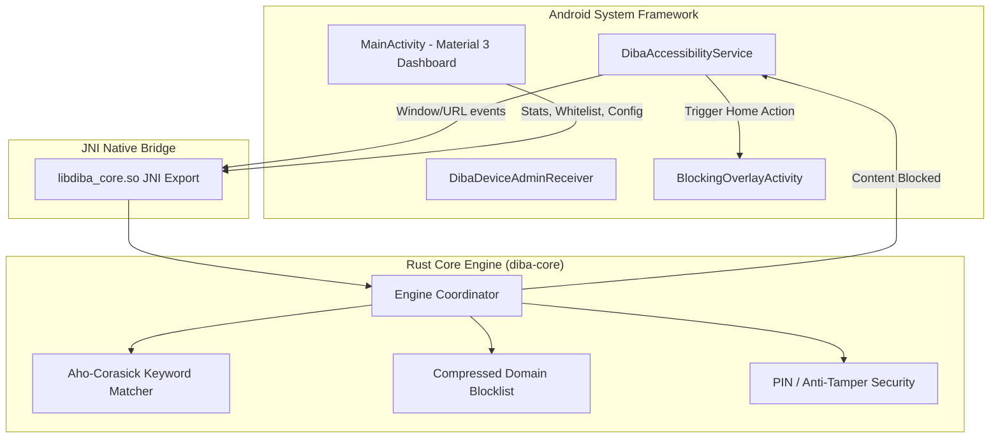

# Diba: Porn Blocker 🛡️

> **Fast, private, and tamper-resistant adult content blocker for Android, powered by a high-performance Rust core engine.**

[](LICENSE)
[](https://developer.android.com)
[](https://www.rust-lang.org)
[](https://github.com/Sami12901/diba-porn-blocker/actions)

---

## 🌟 Overview

**Diba: Porn Blocker** is an open-source digital wellbeing and adult content blocker designed for Android mobile devices (inspired by *BlockerHero - Content Blocker*). It helps individuals stay focused, break unwanted digital habits, and maintain a safe digital environment.

Unlike typical cloud-based blockers that route your web traffic through external servers, **Diba operates 100% locally on your device**:
- **Zero data collection**
- **Zero cloud telemetry**
- **No account or subscription required**
- **Zero latency impact**

All domain matching, explicit keyword scanning, search query tokenization, and obfuscation detection are executed inside **`diba-core`**, a native high-speed engine written in **pure Rust**.

---

## 🚀 Key Features

* **Real-Time Browser URL Inspection**: Intercepts adult and explicit websites across popular browsers (Chrome, Brave, Firefox, Edge, Samsung Internet, Opera, DuckDuckGo, Vivaldi, and more).
* **Instant Home-Kick & Full-Screen Protective Barrier**: Instantly closes forbidden pages and triggers an immersive overlay screen featuring motivational quotes and reason for blocking.
* **Smart Search Engine Query Tokenizer**: Scans queries across Google, Bing, YouTube, Yahoo, and DuckDuckGo to block explicit searches before results appear.
* **Obfuscation & Leetspeak Detection**: Identifies deliberate bypass attempts such as `p.o.r.n`, `p0rn`, `s3x`, spaced terms, and encoded strings.
* **Uninstall Protection (Device Administrator)**: Prevents impulsive uninstallation or force-closing during moments of weakness.
* **Master PIN Protection**: Lock blocker settings, whitelist management, and shield toggles behind a 4-digit security PIN.
* **Custom Blocklist & Whitelist**: Effortlessly add custom domains, URLs, and trigger keywords.
* **Multi-Architecture Native Support**: Pre-compiled Rust `.so` binaries for `arm64-v8a`, `armeabi-v7a`, and `x86_64`.

---

## 🏗️ Architecture



---

## 📥 Download APK

You can download the latest signed production release APK directly from the **[GitHub Releases](https://github.com/Sami12901/diba-porn-blocker/releases)** page:
- `diba-porn-blocker-v1.0.0-release.apk`

---

## 🛠️ Building from Source

### Prerequisites
1. **Rust**: 1.75+ (`rustup target add aarch64-linux-android armv7-linux-androideabi x86_64-linux-android`)
2. **Android SDK & NDK**: NDK r26+ (`platforms;android-34`, `build-tools;34.0.0`)
3. **Java**: JDK 17+

### 1. Compile Rust Core Engine
```bash
cd diba-core
cargo test
cargo build --target aarch64-linux-android --release
cargo build --target armv7-linux-androideabi --release
cargo build --target x86_64-linux-android --release
```

### 2. Copy Shared Libraries
```bash
mkdir -p ../app/src/main/jniLibs/arm64-v8a
mkdir -p ../app/src/main/jniLibs/armeabi-v7a
mkdir -p ../app/src/main/jniLibs/x86_64

cp target/aarch64-linux-android/release/libdiba_core.so ../app/src/main/jniLibs/arm64-v8a/
cp target/armv7-linux-androideabi/release/libdiba_core.so ../app/src/main/jniLibs/armeabi-v7a/
cp target/x86_64-linux-android/release/libdiba_core.so ../app/src/main/jniLibs/x86_64/
```

### 3. Build Release APK
```bash
cd ..
./gradlew assembleRelease
```

---

## 🔒 Privacy & Security

Diba: Porn Blocker does **not** track, record, upload, or transmit any user information. All web inspection and pattern recognition occurs strictly in volatile device memory via local JNI calls.

---

## 📜 License

This project is licensed under the **GNU General Public License v3.0 (GPL-3.0)**. See [LICENSE](LICENSE) for details.
